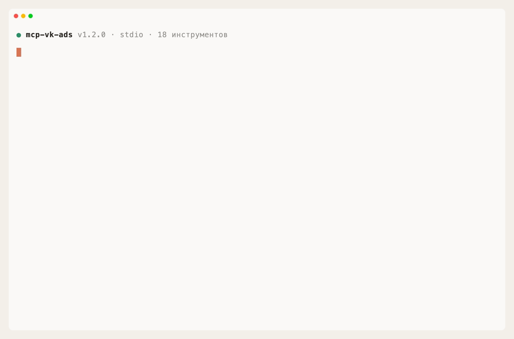

# VK Реклама MCP

[](https://www.npmjs.com/package/mcp-vk-ads)
[](https://github.com/askads/mcp-vk-ads/actions/workflows/ci.yml)
[](https://glama.ai/mcp/servers/askads/mcp-vk-ads)
[](./LICENSE)

**VK Реклама MCP** подключает AI-приложение к рекламному кабинету VK Ads. Можно спросить, какие кампании тратят бюджет без результата, сравнить группы и объявления, подготовить новую кампанию или изменить ставку. Ходить по разделам кабинета не нужно: ассистент сам сопоставит кампании, статистику, баланс и статусы в одном диалоге.

В сервере 23 инструмента: кампании, группы и объявления, загрузка изображений, статистика, баланс, лимиты API, регионы, подключение кабинета и `raw_request` для любого другого метода API.



## Быстрый старт

Нужен Node.js 20 или новее. Сервер запускается через `npx`, поэтому отдельно устанавливать пакет не требуется; токен при установке не нужен.

1. Добавьте сервер в AI-приложение — инструкции для пяти приложений ниже.
2. Скажите: «Подключи ВК Рекламу» — сервер проведёт [подключение](#подключение-кабинета) прямо в диалоге.
3. Начните с запроса только на чтение: «Покажи кампании моего аккаунта VK Рекламы и расход за прошлую неделю по группам объявлений».

<details open>
<summary><strong>Codex</strong></summary>

<br>

**Через интерфейс приложения:**

1. Откройте **Settings → Plugins → MCP servers**.
2. Нажмите **Add server**.
3. Добавьте команду запуска `npx -y mcp-vk-ads@latest`. Переменные окружения не нужны: кабинет подключается в диалоге.

**Через командную строку:**

```bash
codex mcp add vk-ads -- npx -y mcp-vk-ads@latest
```

Проверьте подключение:

```bash
codex mcp list
```

[Официальная инструкция Codex](https://learn.chatgpt.com/docs/extend/mcp?surface=cli)

</details>

<details>
<summary><strong>Claude Code</strong></summary>

<br>

```bash
claude mcp add \
  --transport stdio \
  --scope user \
  vk-ads \
  -- npx -y mcp-vk-ads@latest
```

Проверьте сервер:

```bash
claude mcp list
```

[Документация Claude Code](https://docs.anthropic.com/en/docs/claude-code/mcp)

</details>

<details>
<summary><strong>Claude Desktop</strong></summary>

<br>

Откройте **Settings → Developer → Edit Config** и добавьте сервер в `claude_desktop_config.json`:

```json
{
  "mcpServers": {
    "vk-ads": {
      "command": "npx",
      "args": ["-y", "mcp-vk-ads@latest"]
    }
  }
}
```

Если **Edit Config** недоступна, отредактируйте `~/Library/Application Support/Claude/claude_desktop_config.json` на macOS или `%APPDATA%\Claude\claude_desktop_config.json` на Windows.

</details>

<details>
<summary><strong>Cursor</strong></summary>

<br>

Для всех проектов создайте `~/.cursor/mcp.json`; только для текущего проекта — `.cursor/mcp.json`:

```json
{
  "mcpServers": {
    "vk-ads": {
      "command": "npx",
      "args": ["-y", "mcp-vk-ads@latest"]
    }
  }
}
```

[Документация Cursor](https://docs.cursor.com/context/model-context-protocol)

</details>

<details>
<summary><strong>VS Code</strong></summary>

<br>

Откройте палитру команд и выполните **MCP: Open User Configuration**. Добавьте в `mcp.json`:

```json
{
  "servers": {
    "vk-ads": {
      "type": "stdio",
      "command": "npx",
      "args": ["-y", "mcp-vk-ads@latest"]
    }
  }
}
```

Проверьте запуск командой **MCP: List Servers**.

[Документация VS Code](https://code.visualstudio.com/docs/agent-customization/mcp-servers)

</details>

## Подключение кабинета

Скажите ассистенту «Подключи ВК Рекламу», и он проведёт вас по шагам:

1. Откройте в [кабинете VK Рекламы](https://ads.vk.ru/hq/settings) **Настройки → Общие → Доступ к API** и запросите доступ.
2. Сразу сохраните `client_secret`: кабинет показывает его только 10 минут после запроса и повторно не выдаёт.
3. Пришлите в чат `client_id` и `client_secret`. Сервер получит токен и проверит, к какому кабинету подключился. Перезапускать AI-приложение и править его конфигурацию не нужно.

Если секрет утерян, напишите в поддержку API VK Рекламы: `ads_api@vk.team`.

Токен VK действует около суток, и сервер сам продлевает его по `refresh_token`. Проверить подключение можно фразой «покажи статус подключения», отключить — «отключи ВК Рекламу».

`client_id` и `client_secret` дают полный доступ к рекламному кабинету, включая трату бюджета. Сервер хранит их в `~/.config/mcp-vk-ads/credentials.json` с правами только для владельца (`0600`). `client_secret` хранится потому, что VK требует его при каждом продлении токена. Ни токен, ни `client_secret` не возвращает ни один инструмент; `auth_status` показывает только `client_id`.

Входа через браузер нет: сценарий `authorization_code` VK выдаёт только партнёрам с согласованным `redirect_uri`. Для кабинетов клиентов агентства нужен токен с грантом `agency_client_credentials`: выпустите его по [документации VK Ads API](https://ads.vk.com/doc/api) и передайте в `VK_ADS_TOKEN`.

## Что можно поручить

### Разобраться с расходом и результатом

- «Покажи расход, показы, клики и CTR по кампаниям за последние 7 дней».
- «Какие объявления тратят больше всего и не приносят результата?»
- «Сравни группы объявлений внутри этой кампании по расходу и кликам».

### Понять, почему реклама не показывается

- «Покажи статус, доставку и модерацию всех объявлений этой группы».
- «Какие кампании сейчас остановлены?»
- «Найди объявления, которые не прошли модерацию».

### Подготовить изменения в рекламе

- «Создай текстовую кампанию с дневным бюджетом 5 000 рублей».
- «Измени дневной бюджет этой группы на 1 500 рублей».
- «Останови объявление 12345».

Ставки, бюджеты и расход указываются в валюте кабинета. Такие команды сразу меняют кабинет, см. [Что меняется в кабинете](#что-меняется-в-кабинете).

### Найти данные для настройки

- «Покажи баланс и валюту моего кабинета».
- «Сколько запросов к API осталось?»
- «Найди ID региона Москва для таргетинга».

Сервер не следит за кабинетом в фоне: он работает, только когда его вызывает AI-приложение. Если приложение поддерживает задания по расписанию, настройте в нём периодический запрос статистики или статусов.

## Что меняется в кабинете

| Действие | Что происходит |
|---|---|
| Списки, статистика, баланс, лимиты и регионы | Только чтение. |
| Создание и обновление кампаний, групп и объявлений, загрузка изображений | Сразу создаёт или меняет объект в боевом рекламном кабинете. |
| Действие со статусом | Активирует, останавливает или удаляет объект в живом кабинете. |
| `raw_request` | `GET` читает данные; `POST` и `DELETE` меняют их и требуют `confirmWrite=true`. |

Песочницы у VK Рекламы нет, поэтому перед подтверждением проверьте, что ассистент правильно определил кампанию, группу, объявление и сумму. Флаг `confirmWrite` есть только у `raw_request`; спросит ли вас AI-приложение перед остальными изменениями, зависит от его настроек.

После сетевой ошибки или `5xx` не повторяйте создание вслепую: операция могла успеть примениться. Сначала проверьте список объектов.

## Переменные окружения

Всё нужное сервер спрашивает в диалоге. Переменные окружения пригодятся только для CI и автоматических установок, где диалога нет. Все они необязательные.

| Переменная | Назначение |
|---|---|
| `VK_ADS_TOKEN` | Готовый OAuth2 access-токен VK Ads. Имеет приоритет над входом из чата; такой токен сервер не продлевает и не удаляет. |
| `VK_ADS_LANG` | Язык ответов API; по умолчанию `ru`. |
| `VK_ADS_TIMEOUT_MS` | Таймаут одного запроса; по умолчанию 60 000 мс. |
| `VK_ADS_MAX_RETRIES` | Число повторов при временных ошибках; по умолчанию 3. |
| `VK_ADS_API_BASE` | Базовый адрес API; по умолчанию `https://ads.vk.com/api`. |

Как выпустить токен для `VK_ADS_TOKEN` вручную, описано в [документации по разработке](./docs/DEVELOPMENT.md#ручной-токен-для-vk_ads_token).

## Телеметрия

По умолчанию сервер отправляет анонимную телеметрию: случайный идентификатор установки, имя события или инструмента, версии сервера, Node.js, ОС и AI-клиента.

При вызове инструмента сервер также отправляет его исход, а при ошибке ещё и фрагмент её текста: код и сообщение. В них e-mail, адреса, токены, числа от 4 цифр и текст в кавычках заменены на «#».

Токен, аргументы инструментов, ответы кабинета, ваши сообщения и значения переменных окружения сервер не отправляет. Исключение — текст ошибки: если в нём есть значение из запроса и маска его не закрыла, оно попадёт во фрагмент.

Отключить телеметрию для всех MCP-серверов Ask Ads: `ASKADS_TELEMETRY=0`.

## Техническая документация

- [Каталог MCP-возможностей](./docs/capabilities/index.md) — страницы по пользовательским задачам для каждого инструмента.
- [Все инструменты и параметры](./docs/TOOLS.md) — схемы, статусы объектов, постраничная выдача, таймауты и повторы запросов.
- [Документация по разработке](./docs/DEVELOPMENT.md)
- [Пакет в npm](https://www.npmjs.com/package/mcp-vk-ads)
- [Документация VK Ads API](https://ads.vk.com/doc/api)

## Поддержка

Нашли ошибку или не хватает сценария? [Создайте issue](https://github.com/askads/mcp-vk-ads/issues) или напишите в [Telegram](http://t.me/gistrec).
